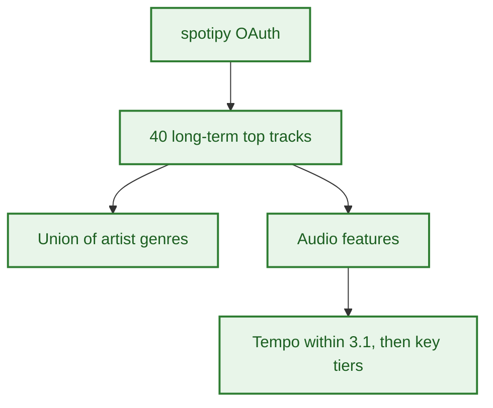
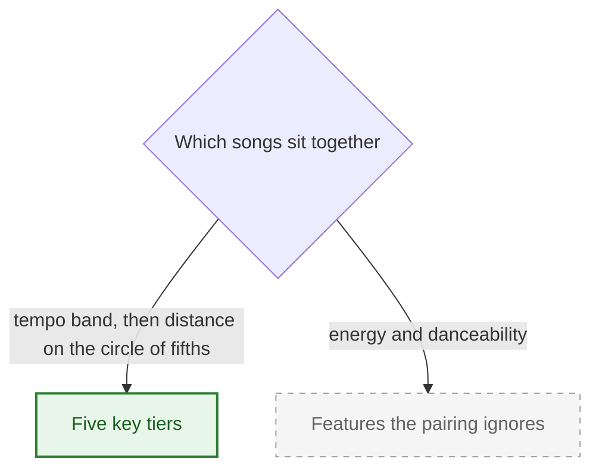

# SpotifyPython

A local Python app (spotipy and Tkinter) that reads your Spotify top tracks, groups them by artist genre, and pairs songs by tempo and key. `SpotifyAPI.py` is the analyzer; `SpotifyCreatePlaylist.py` creates playlists.

## System design

How a request or a run moves through the code, then the choices behind that shape. In the decision charts, a **solid** box is the route this repo takes and a **dashed** box is the alternative it turns down; the edge label is the tradeoff.

### Top tracks to pairs

SpotifyAPI.py uses spotipy. The scopes in the file are playlist-modify-private and user-top-read . Forty long-term top tracks are grouped by the union of their artists’ genres. Pairs inside a 3.1 tempo band are tiered by key distance.

### Tempo and key

Energy and danceability are fetched and then ignored by the pairing. The tiers use tempo and key only. Client id and secret are empty strings in the file. You fill them in locally.

Longer write-up: [aamogh.vercel.app/projects/music-analyzer](https://aamogh.vercel.app/projects/music-analyzer.html)
